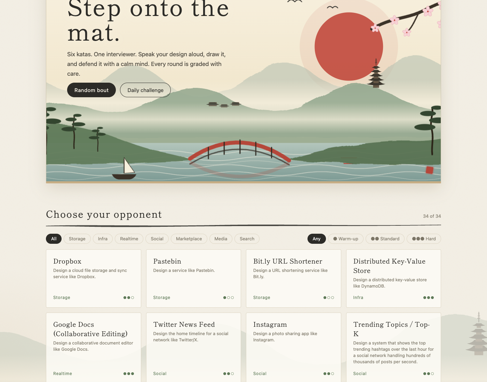
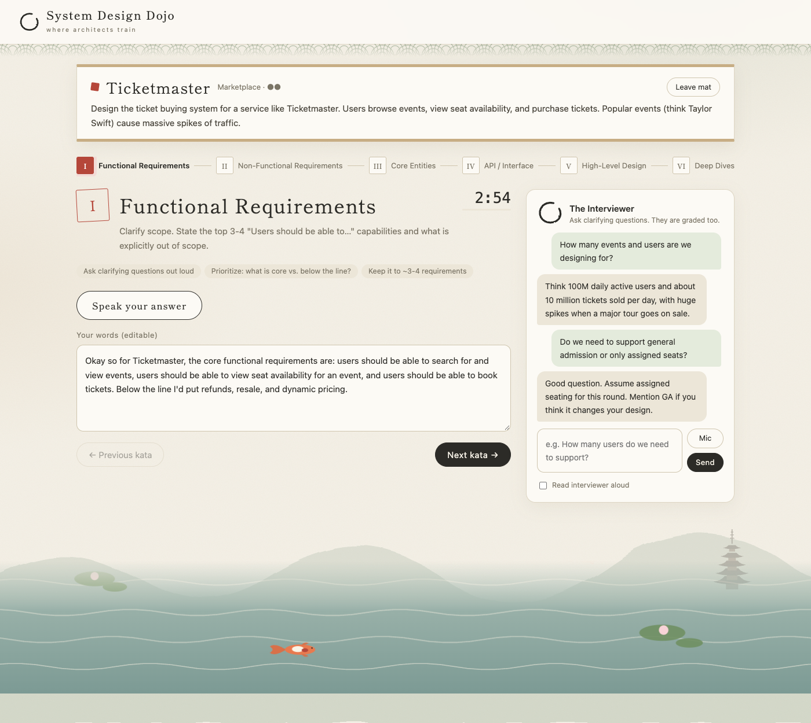
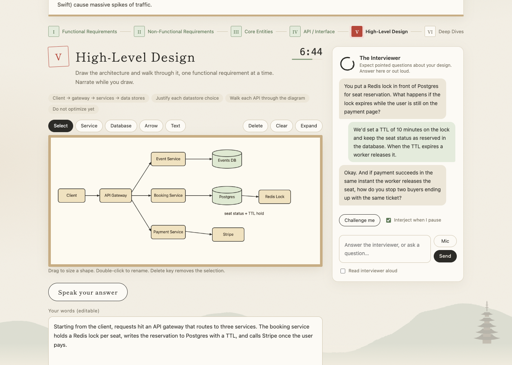
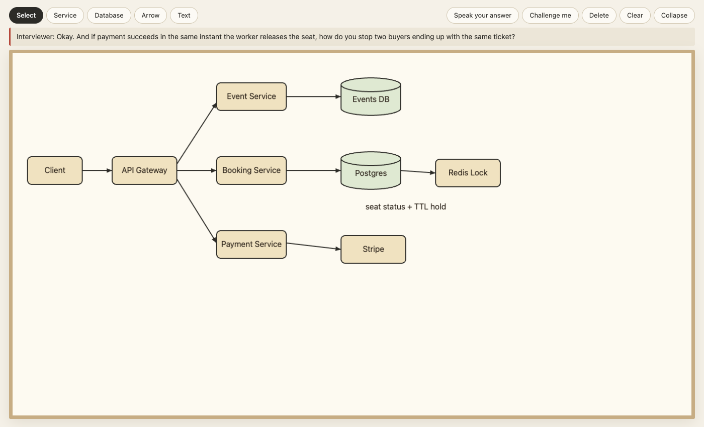
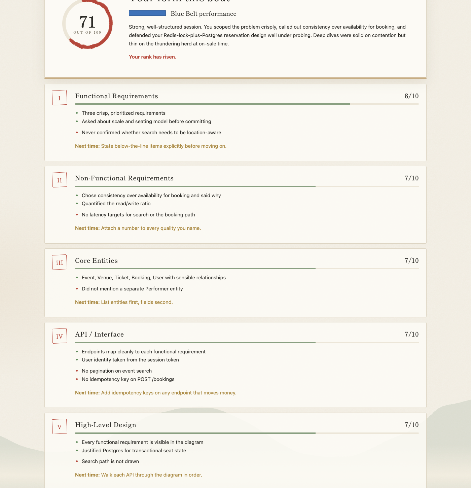

# System Design Dojo

Practice system design interviews out loud, against an AI interviewer that asks follow-ups and grades the whole session at the end. Built around the [Hello Interview](https://www.hellointerview.com) delivery framework, wrapped in a calm Japanese-ink-painting dojo.



## How a session works

You get a realistic problem (Ticketmaster, WhatsApp, a distributed rate limiter, and 30+ more) and work through six stages, each with a timer:

| # | Stage | What you do |
| --- | --- | --- |
| I | Functional requirements | Scope the problem and ask clarifying questions |
| II | Non-functional requirements | Name the qualities that matter, with numbers |
| III | Core entities | List the main nouns and their relationships |
| IV | API / interface | Define the endpoints for each requirement |
| V | High-level design | Draw the architecture on a whiteboard and walk through it |
| VI | Deep dives | Harden the design against the real bottlenecks |

At the end, an LLM reads everything you said, asked, and drew, then scores each stage and the whole session.

## Features

### Talk it through
Dictate with your mic (browser speech recognition) or type. Your words stay editable. Turn on "Read interviewer aloud" to hear the interviewer.



### Ask the interviewer
Chat with the interviewer in every stage. Asking good clarifying questions is part of your grade.

### Get probed on your design
In the high-level design and deep-dive stages the interviewer pushes back on specifics: your actual components, your datastore choices, race conditions, failure modes. It can jump in when you pause speaking, or you can hit **Challenge me**.



### Whiteboard that fills the screen
Draw services, databases, arrows and notes. Drag to move, double-click to rename. Hit **Expand** for a full-screen board that keeps the mic and the interviewer's latest question at hand.



### Graded like a real interview
Every stage gets a score, strengths, gaps and one concrete tip. You also get the topics you never touched and an outline of what a strong answer covers. The grader sees your transcript, your Q&A with the interviewer, and the whiteboard as both an image and a text description.



### Track your progress
- Belts from White to Black, based on the average of your last three sessions
- Score trend chart and saved history of past sessions, which you can reopen
- A daily challenge, plus category and difficulty filters across 34 problems
- Sessions autosave, so you can leave and resume

> The screenshots use sample data (a made-up session and grade) to show the layout.

## Requirements

- Node.js 18+
- [Claude Code](https://claude.com/claude-code) CLI installed and logged in (`claude` on your PATH). Interviewer and grading calls run headless through it, using your Claude subscription. No API key needed.
- A Chromium-based browser (Chrome or Edge) for speech recognition.

## Run

```
git clone https://github.com/tforgach/sysdesign-dojo.git
cd sysdesign-dojo
node server.js
```

Open http://localhost:3000. There are no dependencies to install.

## Configuration

| Env var | Default | Purpose |
| --- | --- | --- |
| `PORT` | `3000` | Port to listen on |
| `HOST` | `127.0.0.1` | Bind address. Keep it local: requests spend your Claude usage |
| `MAX_CALLS_PER_HOUR` | `150` | Cap on AI calls per hour (each interviewer message or grading attempt counts) |
| `GRADER_MODEL` | `sonnet` | Model for end-of-session grading |
| `INTERVIEWER_MODEL` | `haiku` | Model for interviewer chat |

## Security and cost safety

Every interviewer message and grading run spends your Claude subscription usage, so the server is locked down:

- Binds to `127.0.0.1` only, so other machines can't reach it.
- Rejects requests whose `Host` isn't localhost (DNS rebinding) and POSTs whose `Origin` isn't the app itself (other websites can't drive it from your browser). POSTs must be JSON.
- Caps concurrent AI calls (2), calls per hour (`MAX_CALLS_PER_HOUR`), request body size, and input lengths, and kills any call that hangs past 3 minutes.
- No credentials are stored in the app. The `claude` CLI handles its own login.

If you expose it beyond localhost (not recommended), add real authentication first.

## How it works

- `server.js` is a zero-dependency Node server. It serves `public/` and exposes `/api/interview` and `/api/grade`, which spawn `claude -p` with tools, MCP and settings turned off so no local context leaks in. The whiteboard image is handed to the grader through a temp file.
- The frontend is plain HTML, CSS and JavaScript. The whiteboard is a canvas, and all the artwork is inline SVG.
- History and in-progress sessions live in your browser's localStorage. Nothing is stored server-side.

To add problems or change the stages, edit `public/problems.js`.

## License

MIT
